# Zyrelquora

### Shop Smarter. Choose Better.

Zyrelquora is a Smart Shopping Assistant web application developed using Python and Django. It provides users with a convenient shopping experience through product discovery, category filtering, cart management, checkout, order tracking, and shopping insights.

## Technologies Used

- **Frontend:** HTML5, CSS3, Bootstrap 5, JavaScript
- **Backend:** Python, Django
- **Database:** MySQL
- **Charts:** Chart.js
- **Tools:** Visual Studio Code, MySQL Workbench, Git, GitHub

## Key Features

- User registration and login
- Product listing and product details
- Product search and category filtering
- Product pagination
- Shopping cart with quantity management
- Stock availability validation
- Checkout and order placement
- Cash on Delivery
- Order history and order details
- Order cancellation
- User profile management
- Shopping insights and visual analytics

## Project Status

The core development of Zyrelquora is complete. The project source code is available on GitHub. Documentation and final repository improvements are in progress.

## Screenshots

### 1. Homepage

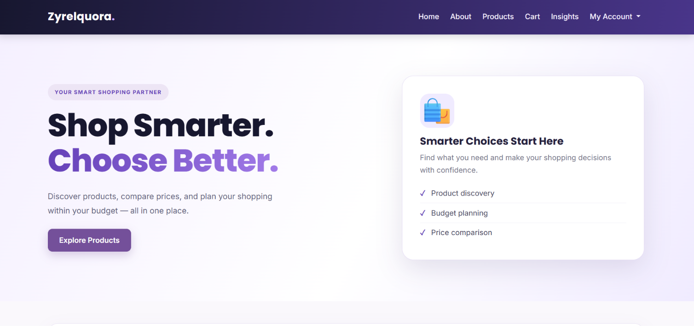

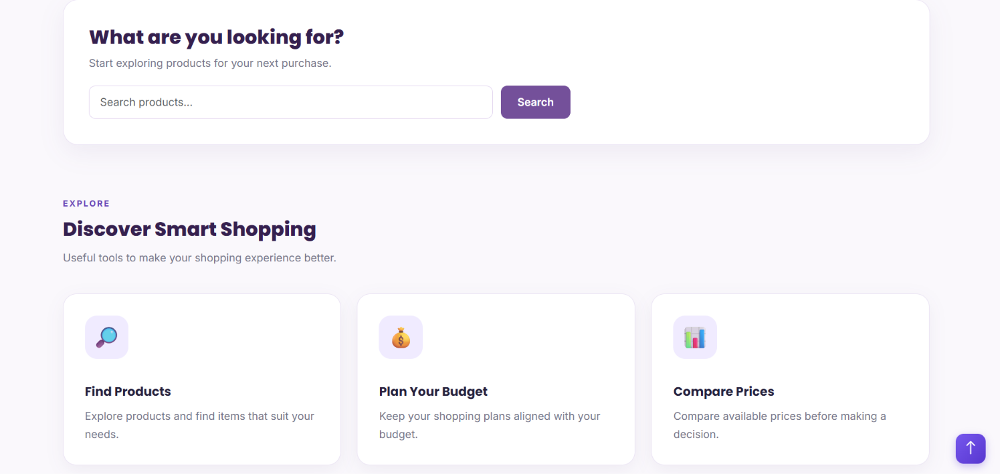

### 2. About


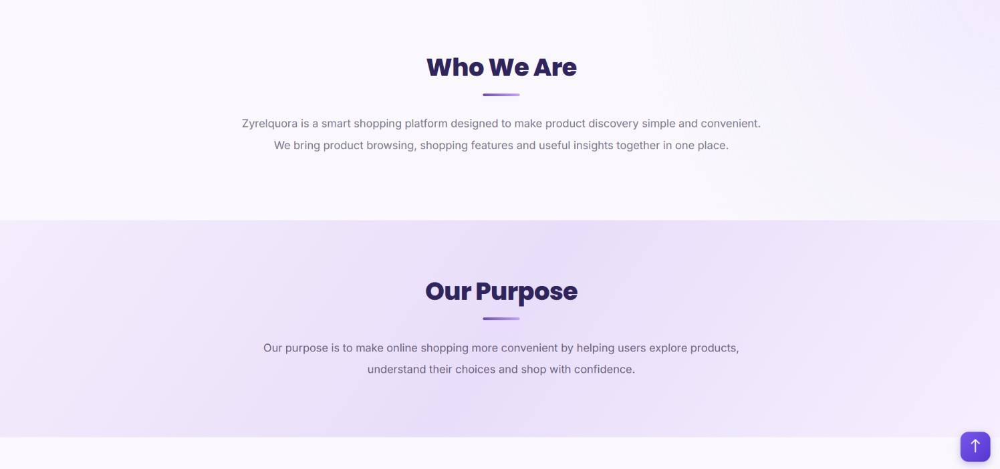

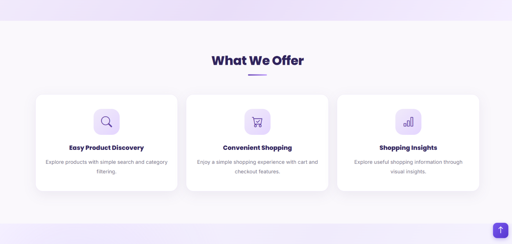

### 3. Products

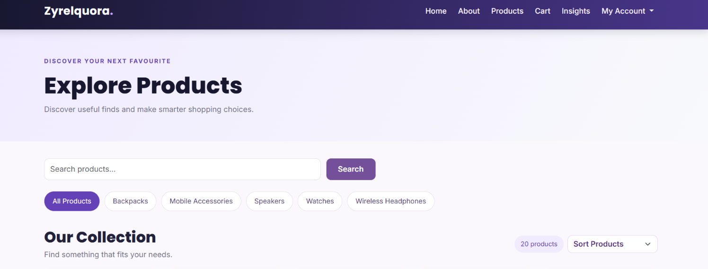


### 4. Shopping Cart

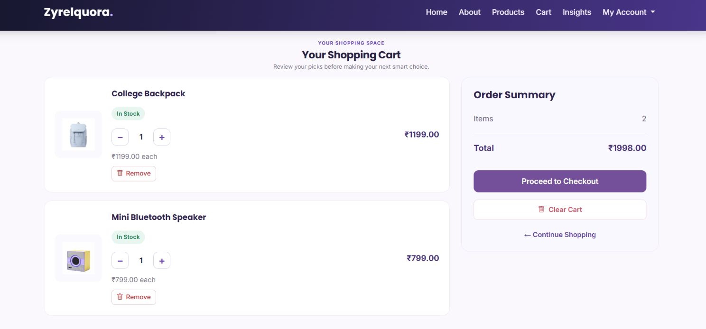

### 5. Checkout

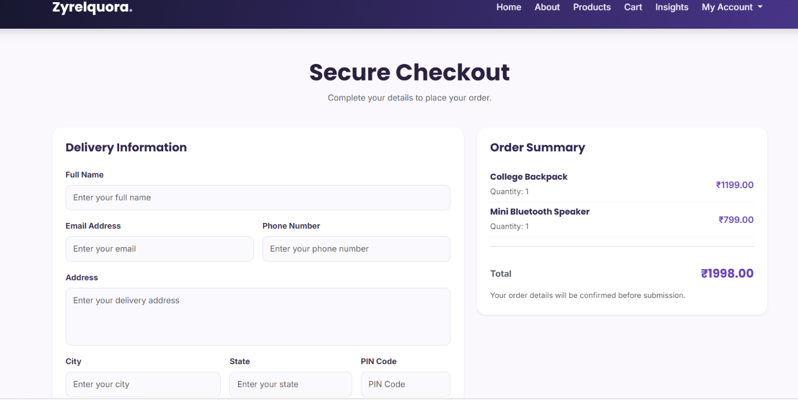

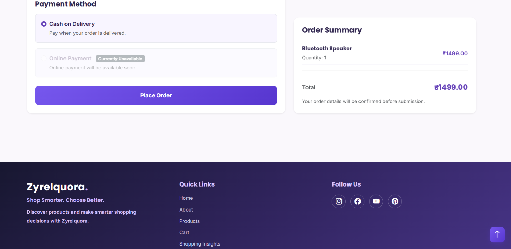

### 6. Order Management

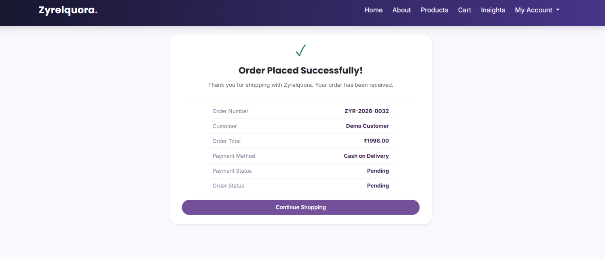

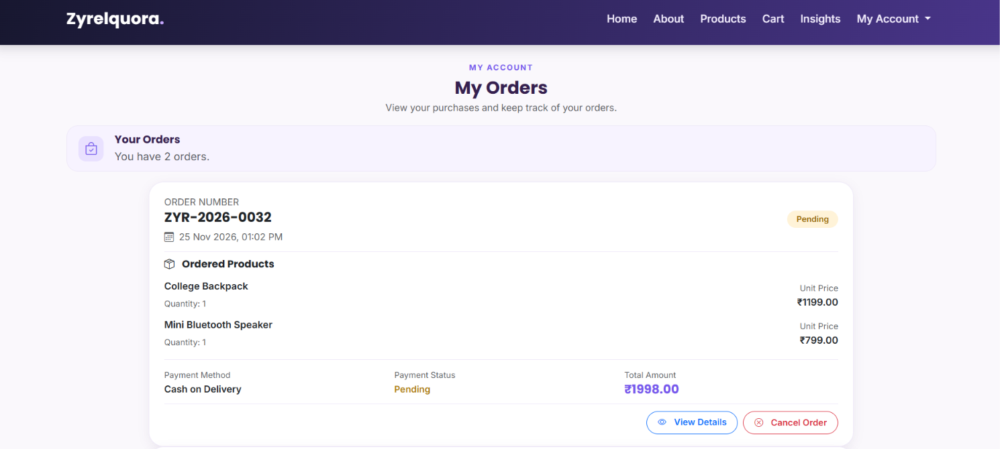

### 7. Shopping Insights

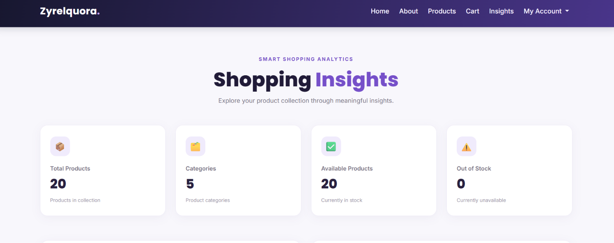

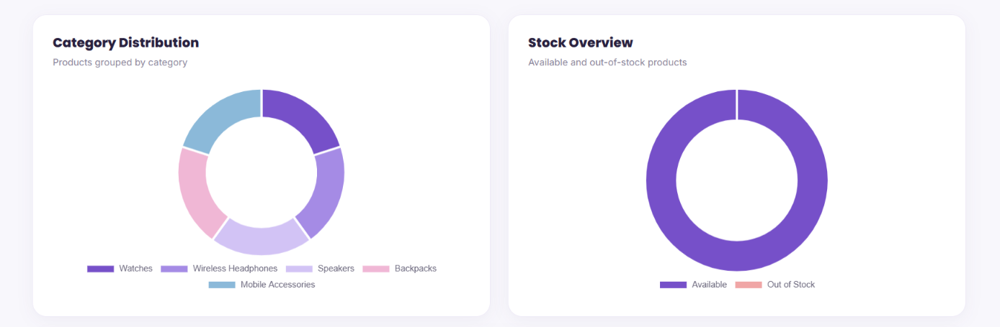

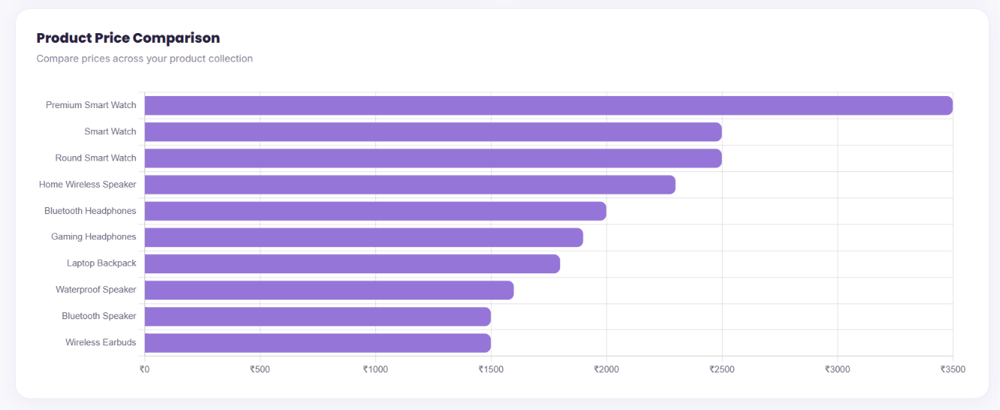

### 8. User Profile

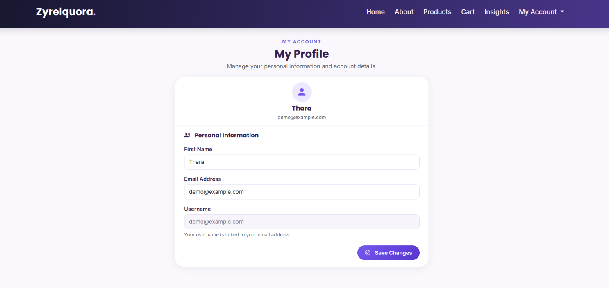

### 9. Authentication


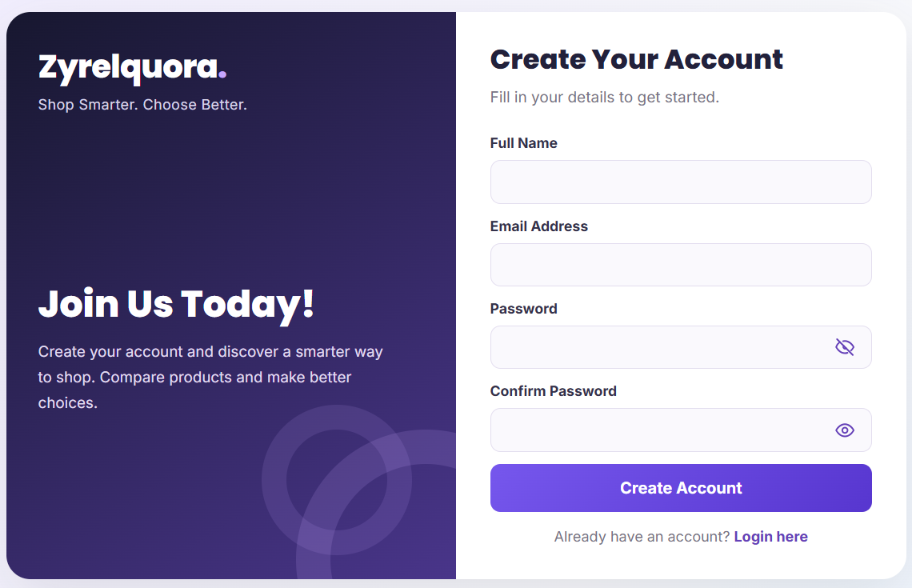

## Installation and Setup

### Prerequisites

- Python 3.9.11
- Django 4.2.30
- MySQL Server
- Git

### 1. Clone the Repository

```bash
git clone https://github.com/sivaabilaav/Zyrelquora.git
cd Zyrelquora
```

### 2. Create and Activate a Virtual Environment

**Windows:**

```bash
python -m venv venv
venv\Scripts\activate
```

### 3. Install Project Dependencies

```bash
pip install -r requirements.txt
```

### 4. Configure Environment Variables

Create a `.env` file in the project root directory and configure the required environment variables for your local setup.

Do not upload this file to GitHub because it contains private configuration values.

## Database Configuration

Zyrelquora uses MySQL as its database.

1. Start your MySQL server.
2. Create a database named `zyrelquora_db`.
3. Configure the database connection details in the `.env` file.
4. Apply the Django migrations.

```bash
python manage.py migrate
```

## Run the Project

After completing the installation and database configuration, start the Django development server:

```bash
python manage.py runserver
```

Open the following address in your browser:

http://127.0.0.1:8000/

## Author

**Siva Abila**

GitHub: https://github.com/sivaabilaav